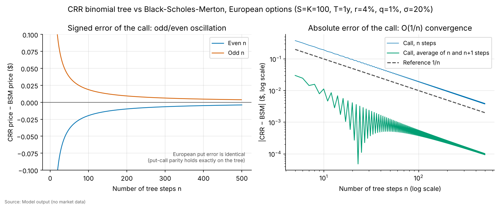
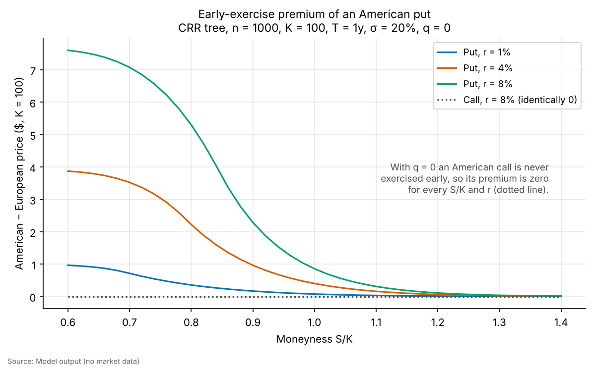
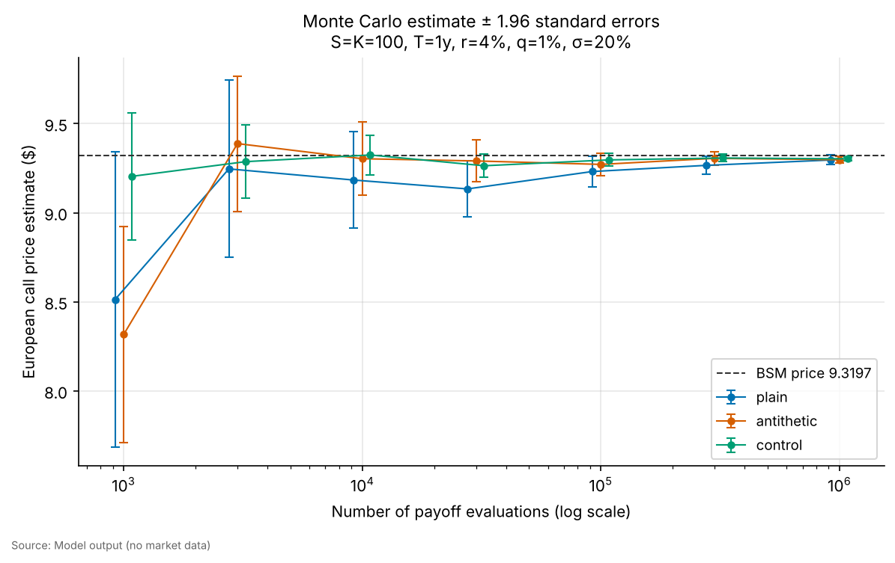
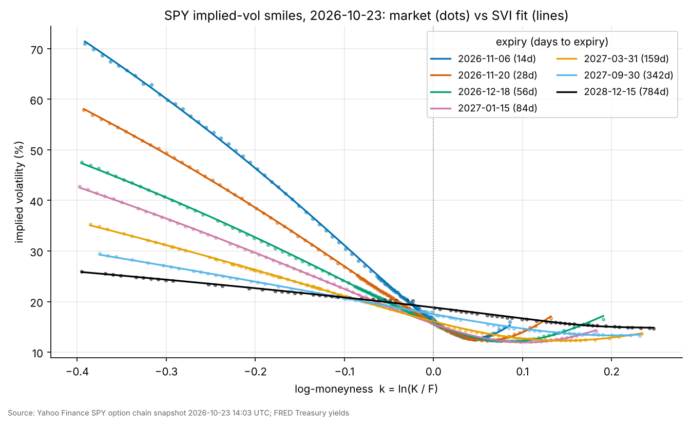
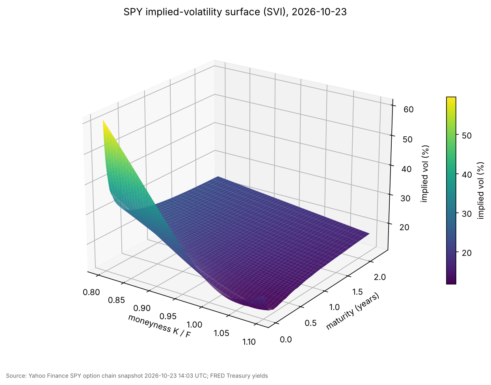
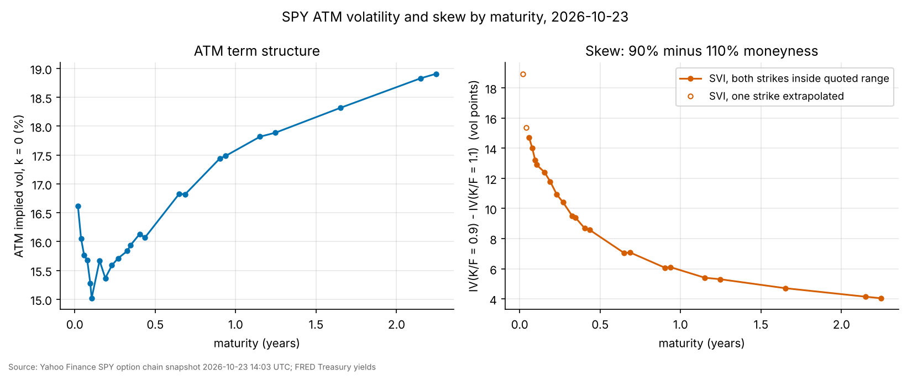
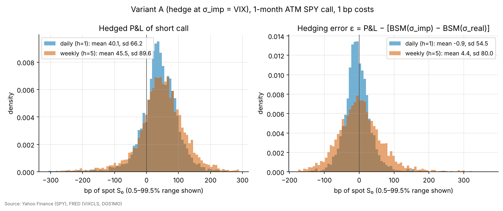
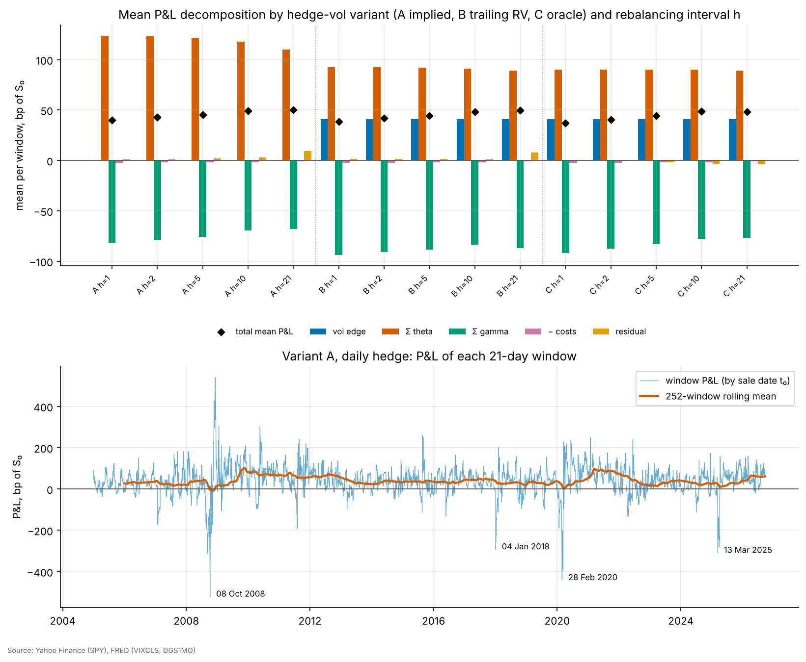
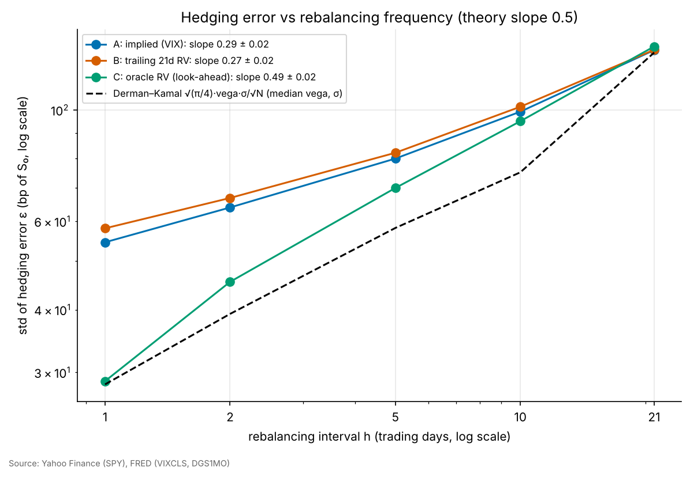
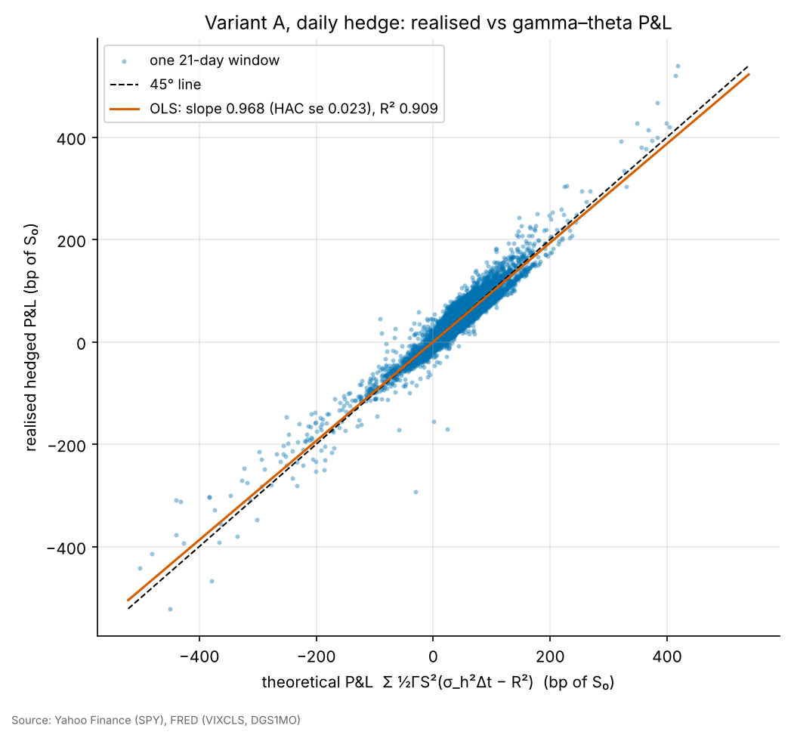

# Option pricing engine, SPY implied-volatility surface and delta-hedging study

**Sam Berman, University College Dublin**

[](https://github.com/samberman-hi/options-pricing-and-hedging/actions/workflows/tests.yml)

**Headline result.** I sold a 1-month at-the-money SPY call on each of 5,465 trading days from 2005 to 2026, priced it at the VIX, and delta-hedged it daily. The hedged position earned **+40 bp of spot per option on average, about 18% of the premium** (Newey–West t = 12.7, p < 10⁻³⁰). That mean is real but it is not free money. 19% of windows lost money, the distribution has strong negative skew, and the worst window (sold 8 Oct 2008) lost **521 bp, 80% of the premium**. Window by window, the realised P&L lines up with the textbook gamma–theta formula Σ ½ΓS²(σ²Δt − R²): regression slope 0.97, not significantly different from 1 (p = 0.15), and R² of 0.91. Hedging error shrinks like √Δt only when the hedge uses the vol that is actually realised. Under that oracle hedge the log–log slope is 0.49 against a theoretical 0.5, and daily hedging leaves a 29 bp error, matching the Derman–Kamal formula's 28 bp. With a hedge vol that is actually tradable (implied or trailing realised), the slope falls to 0.27–0.29: the mis-specified vol adds an error that more frequent rebalancing cannot remove. The pricing library (Black–Scholes–Merton, CRR trees, Monte Carlo) reproduces Hull's textbook values. The SPY surface from 23 Oct 2026 shows a 1-month 90%/110% skew of 13.7 vol points, falling to 5.9 at one year.

---

## 1. Questions

1. **Pricing.** Can a small, tested library price European and American options consistently three ways: closed form, binomial tree and Monte Carlo? How fast do the numerical methods converge, and how much is the right to exercise an American put early worth?
2. **Implied volatility.** Once noisy quotes are cleaned out, what do the SPY smile and surface look like today, and why are they shaped that way?
3. **Hedging.** If you sell a 1-month ATM SPY call and delta-hedge it, what P&L do you actually get, and why? How much comes from theta, from gamma and from trading costs? How does the hedging error change with rebalancing frequency and with the volatility used to compute the hedge?

## 2. Data

All data is free and downloaded by [`src/data.py`](src/data.py), cached in `data/raw/` (gitignored). No values are simulated or filled in by hand; if a source fails the code raises an error.

| Data | Source | Identifier | Period used |
|---|---|---|---|
| SPY daily close (not dividend-adjusted) and cash dividends | Yahoo Finance via `yfinance` | `SPY` | 2004-01-02 to 2026-10-22 (last complete session) |
| SPY option chain (all 28 listed expiries, calls and puts, 9,280 contracts) | Yahoo Finance via `yfinance` | `SPY` | **Snapshot: 2026-10-23 14:03:52 UTC (10:03 New York time), spot $760.88** |
| Risk-free rate, hedging study | FRED | `DGS1MO` (1-month T-bill) | 2005 to 2026 |
| Risk-free curve, surface | FRED | `DGS1MO`, `DGS3MO`, `DGS6MO`, `DGS1`, `DGS2` | latest print (21 Oct 2026, FRED publishes with a lag) |
| Implied vol at sale, hedging study | FRED (fallback: Yahoo `^VIX`) | `VIXCLS` | 2005 to 2026 |

Yahoo Finance and the FRED CSV endpoint both worked, so the Stooq fallback was not needed. Stooq only offers dividend-adjusted prices without the dividends themselves, so `data.py` refuses to use it silently for the hedging study.

**Refreshing the snapshot.** `python -m src.pipeline --refresh-chain` takes a new snapshot and rebuilds every surface figure and table. The snapshot timestamp is stored in `data/raw/spy_chain_meta.json` and `results/surface_summary.json`. Every surface number in this README refers to the snapshot above.

## 3. Method

### 3.1 Pricing library ([`src/bsm.py`](src/bsm.py), [`src/binomial.py`](src/binomial.py), [`src/montecarlo.py`](src/montecarlo.py))

**Black–Scholes–Merton with a continuous dividend yield $q$:**

$$C = S e^{-qT}N(d_1) - K e^{-rT}N(d_2),\qquad P = K e^{-rT}N(-d_2) - S e^{-qT}N(-d_1),$$
$$d_{1} = \frac{\ln(S/K) + (r - q + \tfrac12\sigma^2)T}{\sigma\sqrt{T}},\qquad d_2 = d_1 - \sigma\sqrt T .$$

Greeks are computed in closed form. Delta is $e^{-qT}N(d_1)$ for a call. Gamma is $e^{-qT}n(d_1)/(S\sigma\sqrt T)$. Vega is $Se^{-qT}n(d_1)\sqrt T$, per 1.00 of vol. Theta is per year. Rho is $KTe^{-rT}N(d_2)$ for a call, per 1.00 of rate. Each Greek is checked against central finite differences.

**Put–call parity** for European options says $C - P = Se^{-qT} - Ke^{-rT}$. It is tested to $10^{-10}$ on the model. On market data it is used as a diagnostic (§4.2).

**Cox–Ross–Rubinstein tree.** The tree uses $u = e^{\sigma\sqrt{\Delta t}}$, $d = 1/u$ and $p = (e^{(r-q)\Delta t} - d)/(u-d)$, and rolls back one array per time step. The American version takes $\max(\text{continuation}, \text{exercise})$ at every node. The early-exercise premium is the American price minus the European price on the same tree.

**Monte Carlo.** Terminal prices are sampled exactly from GBM, $S_T = S e^{(r-q-\sigma^2/2)T + \sigma\sqrt T Z}$. Three variance-reduction schemes are compared with the plain estimator at the same number of payoff evaluations:
- **Antithetic** variates pair $Z$ with $-Z$. The standard error is computed from the n/2 pair averages, because the two halves of a pair are not independent.
- A **control variate** uses the discounted terminal stock price, whose mean $Se^{-qT}$ is known: $\hat V = \bar Y - b^*(\bar X - Se^{-qT})$ with $b^* = \widehat{\mathrm{Cov}}(Y,X)/\widehat{\mathrm{Var}}(X)$.
- **Both** combined.

### 3.2 Implied volatility and the surface ([`src/implied_vol.py`](src/implied_vol.py), [`src/surface.py`](src/surface.py))

**Solver.** Newton–Raphson on vega, $\sigma_{n+1} = \sigma_n - (V(\sigma_n) - V^{mkt})/\mathcal V(\sigma_n)$:
- **Starting point.** Away from the money it starts from the Manaster–Koehler point $\sigma_0 = \sqrt{2|\ln(F/K)|/T}$, the inflection point of price in σ, from which Newton converges monotonically. Near the money it uses the Brenner–Subrahmanyam ATM approximation.
- **Acceptance.** A solution is accepted only if both the price error and the implied step in σ are tiny, because when vega is near zero a small price error can hide a large σ error.
- **Fallback.** If Newton leaves the bracket [0.0001, 5] or vega vanishes, the solver falls back to Brent's method, which always converges because price rises strictly with σ.
- **No solution.** Prices outside the no-arbitrage bounds return NaN.

**Inputs for each option.**
- **Time to expiry:** $T$ = time from the snapshot to 16:00 New York on the expiry date, in calendar years.
- **Rate:** $r(T)$ is linearly interpolated from the FRED Treasury curve, converted with $r = \ln(1 + y/100)$.
- **Dividend yield:** $q$ = trailing-12-month SPY cash dividends divided by spot, 0.99%.
- **Forward:** $F = Se^{(r-q)T}$, and moneyness is $k = \ln(K/F)$.

**Cleaning.** Each step below is counted in `results/chain_cleaning.csv`:
- drop quotes with zero bid or a crossed market;
- drop stale quotes (no trade in the last 3 business days);
- drop quotes whose spread is more than 50% of the mid;
- drop expiries under 7 days;
- keep $-0.4 \le k \le 0.25$;
- keep **out-of-the-money options only** (puts with K < F, calls with K ≥ F);
- price at the bid–ask mid.

SPY options are American. OTM options are the liquid side of the market and carry little early-exercise value, so pricing them with BSM is the standard approximation. Its size is measured in §4.2.

**Smile model.** Each expiry is fitted with raw SVI on total implied variance $w(k) = \sigma^2 T$:
$$w(k) = a + b\left(\rho(k-m) + \sqrt{(k-m)^2 + s^2}\right).$$

The fit is tested out of sample: every 5th strike is held out, the curve is fitted on the rest, and the RMSE is reported on both sets. The final curves are then refitted on all strikes. The 3D surface interpolates total variance linearly in $T$ at fixed $k$. Calendar arbitrage (total variance falling with maturity) is checked on a grid.

### 3.3 Delta-hedging study ([`src/hedging.py`](src/hedging.py), [`src/stats.py`](src/stats.py))

**Trade.** On every trading day $t_0$ from 2005-01-03 that has 21 trading days of data after it (5,465 windows), sell one European call:
- **Strike and expiry:** $K = S_{t_0}$ (the close), expiring after 21 trading days.
- **Price:** BSM with $\sigma_{imp}$ = VIX/100, $r$ = the 1-month T-bill rate and $q$ = the trailing dividend yield, all known at $t_0$.
- **Hedge:** hold Δ SPY shares, trading at the close every $h \in \{1, 2, 5, 10, 21\}$ trading days. Here 1 is daily, 5 is weekly and 21 means only the initial hedge.

**Bookkeeping.**
- **Cash:** earns $r$, and the share position receives the actual cash dividends on ex-dates.
- **Transaction costs:** 1 bp of traded notional on every share trade, including the unwind at expiry, with 0 and 5 bp as sensitivities.
- **Settlement:** the call is cash-settled.
- **Units:** P&L is reported in bp of $S_{t_0}$.

**Volatility used to compute delta.**
- **A, implied:** $\sigma_h = \sigma_{imp}$, the VIX at sale.
- **B, forecast:** $\sigma_h$ = trailing 21-day realised vol at $t_0$, known at sale.
- **C, oracle:** $\sigma_h$ = the realised vol of the window itself. *This uses future data and is only a theoretical benchmark, not a tradable strategy.*

**Theory and decomposition.** Short the option, hold Δ shares and keep $V - \Delta S$ in cash. Over a step, $d\Pi = -dV + \Delta(dS + qS\,dt) + r(V - \Delta S)dt$. A Taylor expansion of $dV$ and the BSM PDE $\Theta + (r-q)S\Delta + \tfrac12\sigma^2S^2\Gamma - rV = 0$ cancel every term except

$$d\Pi \approx \tfrac12 \Gamma S^2\left(\sigma_h^2\,\Delta t - R^2\right),\qquad R = \Delta S/S .$$

Summing over the life of the option gives the textbook result, here with the sign flipped because we are short gamma:

$$\text{P\&L}_{short} \approx \underbrace{V(\sigma_{imp}) - V(\sigma_h)}_{\text{vol edge}} + \sum_i \tfrac12\Gamma_i S_i^2\left(\sigma_h^2 - \sigma_{realised,i}^2\right)\Delta t .$$

Each window's P&L is split into five parts: the vol edge, Σ theta ($+\tfrac12\Gamma S^2\sigma_h^2\Delta t$), Σ gamma ($-\tfrac12\Gamma S^2R^2$), −transaction costs, and a residual. The residual collects discrete rebalancing, higher-order terms, discrete dividends and interest on the P&L.

**Hedging error.** The hedging error is defined as $\varepsilon = \text{P\&L} - [V(\sigma_{imp}) - V(\sigma_{real})]$. It measures how far the result lands from the P&L Black–Scholes says you lock in if you know the realised vol. For a hedge at the true vol rebalanced $N$ times, Boyle–Emanuel and Derman–Kamal give $\mathrm{sd}(\varepsilon) \approx \sqrt{\pi/4}\,\mathcal V\sigma/\sqrt N$, so the error should grow like $\sqrt{\Delta t}$, a slope of 0.5 on a log–log plot.

**Statistics.**
- The windows overlap by up to 20 days, so means are tested with **Newey–West (HAC) standard errors, Bartlett kernel, lag 20**.
- As a robustness check, I also run a plain t-test on the 261 non-overlapping windows.
- The regression of P&L on the theoretical P&L uses HAC standard errors.
- Normality is tested with Jarque–Bera.

## 4. Results

### 4.1 Pricing library

| Check | This library | Hull |
|---|---|---|
| European call / put (S=42, K=40, r=10%, σ=20%, T=0.5), Ex. 15.6 | 4.7594 / 0.8086 | 4.76 / 0.81 |
| Index call with dividends (S=930, K=900, r=8%, q=3%, σ=20%, T=2/12) | 51.833 | 51.83 |
| Greeks (S=49, K=50, r=5%, σ=20%, T=0.3846): Δ, Γ, vega, Θ/yr, ρ | 0.522, 0.0655, 12.11, −4.31, 8.91 | 0.522, 0.066, 12.1, −4.31, 8.91 |
| Implied vol (c=1.875, S=21, K=20, r=10%, T=0.25) | 23.45% | 23.5% |
| American put CRR (S=K=50, r=10%, σ=40%, T=5/12), 5 / 30 / 100 / 500 steps | 4.488 / 4.263 / 4.278 / 4.283 | 4.49 / 4.263 / 4.278 / 4.283 |

**Convergence and early exercise** (S = K = 100, T = 1, r = 4%, q = 1%, σ = 20%):
- **CRR error:** the European put error is −0.0196 at 100 steps and −0.0020 at 1,000, so the error is O(1/n).
- **Oscillation:** the error alternates in sign between odd and even n. Averaging the n- and (n+1)-step prices cuts the error at n = 1,000 to about 5×10⁻⁵.
- **Early-exercise premium:** the American put is worth 6.701 against a European 6.394, a premium of 0.31. The premium rises with the interest rate and with how far in the money the put is (Figure 2). It is exactly zero for a call on a non-dividend-paying stock, as theory requires.

| Monte Carlo, 100,000 payoffs, ATM call (BSM = 9.3197) | Estimate | Std. error | Error / SE | Variance reduction |
|---|---|---|---|---|
| Plain | 9.2882 | 0.0441 | 0.72 | 1.0× |
| Antithetic | 9.2891 | 0.0329 | 0.93 | 1.8× |
| Control variate (discounted S_T) | 9.3080 | 0.0181 | 0.64 | 5.9× |
| Antithetic + control | 9.3108 | 0.0092 | 0.97 | **23.2×** |





### 4.2 SPY implied-volatility surface (snapshot 2026-10-23 14:03 UTC, spot $760.88)

**Cleaning:** 9,280 raw contracts left 2,688 clean OTM quotes across 23 expiries, from 7 days to 2.2 years. The stale-quote filter removes the most rows, mostly deep ITM contracts that rarely trade. Newton converged on all 2,688 options, Brent was never needed, and none failed.

| Summary | Value |
|---|---|
| ATM implied vol, 1 month / 1 year | 15.5% / 17.6% |
| Skew, IV(90% K/F) − IV(110% K/F), 1 month / 1 year | 13.7 / 5.9 vol pts |
| SVI RMSE, median across expiries, in-sample / **held-out strikes** | 0.13 / **0.13** vol pts |
| Calendar-arbitrage violations on the fitted surface | 0 of 1,122 grid points |
| Put–call parity forward vs model forward, expiries ≤ 1.2y | within ±16 bp (median −4 bp) |
| American-tree IV − BSM IV, all OTM options in the 1M and 1Y expiries | median 0.04, max 1.27 vol pts |

**What the skew means.** Out-of-the-money puts are much more expensive than out-of-the-money calls. On the 1-month expiry, a put struck 10% below the forward trades at about 14 vol points more than a call struck 10% above. There are two reasons:
- **Demand.** Investors hold long equity portfolios and pay up for crash protection. Dealers who sell them that protection are left short downside gamma and charge for it.
- **Leverage.** Index volatility tends to jump when the market falls, so the market-implied return distribution has a fatter left tail than the lognormal Black–Scholes assumes.

The skew is steepest at short maturities and flattens as maturity grows, falling from 13.7 vol points at 1 month to 5.9 at 1 year and 4.0 at 2.2 years. The ATM slope dσ/dk falls roughly like 1/√T. A given percentage crash is a much bigger move relative to one month of expected volatility than to two years of it. Short-dated smiles also curl back up slightly in the far call wing.

**What the term structure means.** At-the-money vol is slightly inverted over the first few weeks, 16.6% at 7 days against 15.0% at about 5 weeks. That reflects near-term event risk being priced. Beyond about two months it slopes upward, reaching 17.6% at 1 year and 18.9% at 2.2 years. That is the normal shape in a calm market: today's vol (VIX ≈ 19 at the last close, ATM 1-month ≈ 15.5%) sits below the long-run average, so investors expect vol to drift back up over time, and long-dated options also carry a premium for uncertainty about volatility itself.

**Diagnostics (reported, not hidden).**
1. **Parity.** The forward implied by put–call parity, $F = K + e^{rT}(C - P)$, agrees with the model forward to within ±16 bp out to 1.2 years. It sits 33–106 bp below the model forward at the three longest expiries. In those expiries early exercise of the American puts raises P, the dividend stream is not flat, and there are few strike pairs.
2. **Early exercise.** A 200-step American tree recovers almost the same IV as BSM for 1-month options (≤ 0.17 vol pts). For the 1-year expiry it is 0.1–1.3 vol pts lower for puts struck between spot and the forward. Those puts are OTM against the forward but ITM against spot, and with r ≈ 4.4% > q ≈ 1% their early-exercise right is worth something. The BSM surface therefore slightly overstates long-dated put vols near the money.
3. **SVI fit.** Some long-dated SVI slices sit at a bound for ρ or have unstable parameters. The fitted curve is accurate where there is data, but the wings beyond the quoted range should not be trusted (3 slices breach Lee's wing-slope bound of 2).





### 4.3 Delta-hedging a short 1-month ATM SPY call (5,465 windows, 2005-01-03 to 2026-09-23 sale dates, 1 bp costs)

P&L figures are in bp of spot at sale. The average premium is 220 bp. HAC t-stats use 20 lags; the non-overlapping t-test uses 261 windows.

| Hedge vol | h (days) | Mean P&L | Std | % of premium | HAC t | Non-overlap t | sd(ε) |
|---|---|---|---|---|---|---|---|
| A: implied (VIX) | 1 (daily) | **40.0** | 66.2 | 18.4% | 12.7 | 8.9 | 54.5 |
| A: implied (VIX) | 5 (weekly) | 45.4 | 89.6 | 20.1% | 12.1 | 9.3 | 80.0 |
| A: implied (VIX) | 21 (initial only) | 50.1 | 147.1 | 22.3% | 8.1 | 6.1 | 131.6 |
| B: trailing 21d RV | 1 | 38.5 | 68.5 | 17.6% | 12.1 | 7.6 | 58.1 |
| B: trailing 21d RV | 5 | 44.2 | 91.4 | 19.5% | 11.9 | 8.8 | 82.2 |
| C: oracle RV (look-ahead) | 1 | 36.9 | 83.0 | 17.0% | 8.8 | 7.4 | **28.8** |
| C: oracle RV (look-ahead) | 5 | 44.2 | 99.4 | 19.8% | 10.1 | 9.1 | 69.9 |

All p-values are below 10⁻⁸. The full table, including h = 2 and h = 10, is in `results/hedging_summary.csv`.
- **Win rate:** 81% of windows make money.
- **Shape:** skewness ranges from −0.5 to −3.1 and excess kurtosis from 7.5 to 21.5, and Jarque–Bera rejects normality everywhere.

**1. Why is the mean positive?** The decomposition (variant A, daily) answers it: **theta +123.5 bp, gamma −82.1 bp, costs −2.4 bp, residual +1.1 bp, total 40.0 bp**. The seller collects time decay priced at implied vol and pays out convexity at realised vol. Over this sample VIX averaged 19.1% and realised 1-month vol 15.5%, so theta won on average.
- **Overstated premium.** Part of the gap is mechanical. VIX is a variance-swap rate and includes the skew, so it sits above ATM implied vol, which overstates the premium the seller actually receives (Limitations).
- **Scope.** This study is about hedging mechanics. Measuring the volatility risk premium properly is a separate project, so I don't claim a clean premium estimate here.

**2. Theory holds window by window.** Regressing each window's realised P&L on its theoretical $\sum \tfrac12\Gamma S^2(\sigma_h^2\Delta t - R^2)$ gives:
- slope **0.968**, HAC SE 0.022;
- a test of slope = 1 gives t = −1.45, p = 0.15, so not rejected;
- intercept 0.005 bp and **R² = 0.91**.

The 9% left unexplained is the residual, with an sd of 20 bp. It comes mostly from third-order terms on crash days, when a −10% day makes a second-order Taylor expansion inaccurate, and from measuring gamma at the start of each day.

**3. Hedging error and frequency.**
- **Oracle hedge.** Hedging at the vol that is actually realised removes the vol-mismatch term. sd(ε) then scales with slope **0.49 ± 0.02** in log h, against 0.5 in theory. Daily hedging leaves **28.8 bp** of error, against the Derman–Kamal approximation $\sqrt{\pi/4}\,\mathcal V\sigma/\sqrt N$ = 28.4 bp, and weekly hedging leaves 2.4× as much.
- **Tradable hedges.** With implied or trailing-realised vol, the slope is only **0.29 / 0.27**, and moving from weekly to daily cuts the error by only 1.4–1.5×. When $\sigma_h \neq \sigma_{realised}$ the P&L contains $\sum\tfrac12\Gamma S^2(\sigma_h^2 - \sigma_{real}^2)\Delta t$, which depends on the path through Γ and does not shrink with rebalancing. **More frequent hedging removes the discretisation noise, not the vol bet.**
- **Daily vs weekly.** Weekly hedging at implied vol raises the P&L sd from 66 to 90 bp. On the variance-weighted metric, daily rebalancing is clearly worth its 2.4 bp of costs at 1 bp per trade.

**4. Mean P&L vs frequency (a marginal result).** Mean P&L *rises* slightly as hedging gets less frequent, from 40 bp daily to 50 bp for initial-hedge-only. The paired difference is +10.0 bp, HAC t = 2.1, p = 0.03, and lower costs explain only about 1.4 bp of it. One explanation is that an under-hedged short-gamma book trades against the market and so benefits from short-horizon mean reversion in SPY. I treat this as **weak evidence**: p = 0.03 among many comparisons does not survive a multiple-testing correction, and I did not test the explanation.

**5. Transaction costs.** Daily hedging pays about 2.4 bp of spot per 1 bp of cost rate. At 5 bp the daily mean falls to 30.4 bp, still significant (t = 9.7).

**6. Tail risk.** The worst windows are all crash episodes:

| Sold on | P&L | VIX at sale | Realised vol in window |
|---|---|---|---|
| 2008-10-08 | −521 bp (−80% of premium) | 57.5 | 90.4% |
| 2008-10-07 | −467 bp | 53.7 | 88.7% |
| 2020-02-28 | −442 bp | 40.1 | 90.8% |
| 2020-02-27 | −414 bp | 39.2 | 90.1% |
| 2020-03-06 | −393 bp | 41.9 | 91.8% |






## 5. Assumptions and limitations

**Pricing**
- Constant σ, r and q within each pricing problem; GBM dynamics in the Monte Carlo and the tree.
- Dividends are a continuous yield, not discrete cash amounts.

**Surface**
- *Snapshot.* One intraday snapshot, with Yahoo quotes delayed up to about 15 minutes. Spot was recorded at download time, so the spot and option timestamps are not perfectly synchronised; 1 bp of spot is about 8 cents.
- *Rates.* FRED yields are constant-maturity Treasury yields used as the risk-free rate (not OIS/SOFR), with a 1–2 day publishing lag.
- *Dividend yield.* q is a single trailing yield. SPY pays quarterly, so the true forward has steps. The parity diagnostic shows the effect is a few bp out to about 1 year.
- *American exercise.* IVs use the European BSM model on American options. This is measured to be negligible at 1 month but worth up to 1.3 vol points for some 1-year puts (§4.2).
- *SVI.* No arbitrage-free constraints are imposed beyond the parameter bounds; calendar arbitrage is checked rather than enforced, and the SVI wings are unreliable beyond the quoted strikes.

**Hedging study**
- **VIX stands in for the 1-month ATM implied vol.** A free daily history of SPY ATM implied vol does not exist. VIX is a 30-calendar-day variance-swap rate and typically 1–3 vol points above ATM IV because of the skew. This biases the premium, and so the mean P&L, upward; it does not affect the gamma–theta mechanics or the scaling results.
- *Execution.* The option is assumed to be sold at the VIX-implied mid with no option bid–ask cost, and the stock is traded at the close with no market impact. Costs are a flat 1 bp of notional.
- *Contract.* The call is treated as European and cash-settled; the real SPY option would be American and physically settled. There is no early-exercise risk for a short call except around ex-dividend dates, which is not modelled.
- *Time.* Time is measured in trading days, with 252 per year. VIX is quoted on a calendar basis, but 21/252 and 30/365 differ by under 2% in total variance.
- *Overlap.* The 5,465 windows overlap heavily, so the effective sample is about 261 independent months. That is why HAC and non-overlapping tests are reported. The Jarque–Bera test and the scaling-slope standard error assume independence and are descriptive only.
- *Look-ahead.* Variant C uses future information and exists only as a theoretical benchmark. Variants A and B use only information available at the close on the sale date.

## 6. Reproduce in 3 commands

```bash
pip install -r requirements.txt
python -m src.pipeline          # downloads data on first run, rebuilds figures/ and results/ (~1 min)
python -m pytest                # 190 unit tests (~3 s)
```

Add `--refresh-chain` to the pipeline to take a new option-chain snapshot. To re-execute the notebook, run `jupyter nbconvert --to notebook --execute --inplace notebooks/analysis.ipynb`.

## Repository layout

```
src/
  bsm.py             BSM price, Greeks, put-call parity gap
  implied_vol.py     Newton + Brent implied-vol solver
  binomial.py        CRR European/American trees, early-exercise premium
  montecarlo.py      MC with antithetic and control variates, standard errors
  data.py            downloads and caching (Yahoo Finance, FRED, Stooq fallback)
  surface.py         chain cleaning, IVs, parity check, SVI fit, surface
  hedging.py         delta-hedging engine, P&L decomposition, hedging error
  stats.py           Newey-West HAC, t-tests, moments
  pricing_report.py  convergence and variance-reduction figures/tables
  pipeline.py        runs everything end to end
notebooks/analysis.ipynb   end-to-end run with outputs
figures/   results/   tests/
docs/methodology-qa.md     the hardest interview questions, with answers
```

## References

- Hull, J. C., *Options, Futures, and Other Derivatives*: the textbook examples used in the tests.
- Cox, Ross & Rubinstein (1979), "Option pricing: a simplified approach".
- Manaster & Koehler (1982), "The calculation of implied variances from the Black–Scholes model".
- Gatheral, J. (2006), *The Volatility Surface* (SVI).
- Boyle & Emanuel (1980), "Discretely adjusted option hedges"; Derman & Kamal (1999), "When you cannot hedge continuously".
- Newey & West (1987), "A simple, positive semi-definite, heteroskedasticity and autocorrelation consistent covariance matrix".

MIT licence; see [LICENSE](LICENSE).
